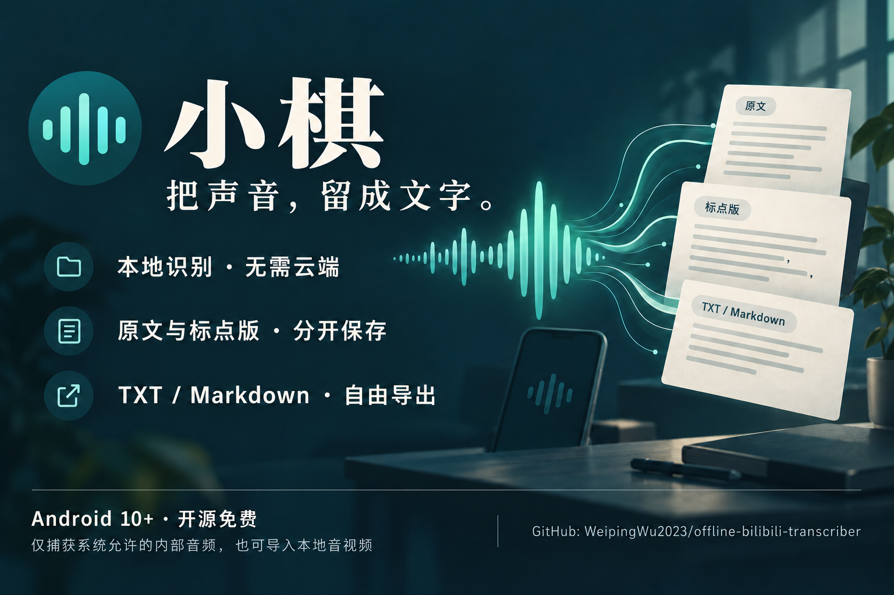

# 小棋

**把声音，留成文字。** Android 10+ 原生离线音频转写工具：捕获系统允许的内部播放音频，或导入自己的音视频，在手机上生成中文原文、标点版和独立编辑稿。



[下载最新版本](https://github.com/WeipingWu2023/offline-bilibili-transcriber/releases/latest) · [详细使用说明](docs/APP_GUIDE.md) · [常见问题](docs/FAQ.md) · [实际验证范围](docs/OFFLINE_TEST_RESULTS.md)

## 先了解这几件事

- **完全本地处理**：SenseVoice Small INT8、Silero VAD、CT-Transformer 通过 sherpa-onnx 在手机运行。APK没有 INTERNET 权限，没有云API或后端。下载APK/模型需要网络，导入后转写可断网。
- **捕获有条件**：只录制 Android 和源应用允许捕获的内部音频，不使用麦克风、不绕过 DRM、不要求 root。系统录屏能录到声音，不代表第三方应用一定能录到。
- **已验证的范围**：红米 Note 13 / Android 14 / 官方 Bilibili 9.13.0 的一次普通点播已录到对应讲话并回听确认，既有短录音完成了离线原文及标点版转写。其他设备、直播、会员内容、长录音没有完整验收。
- **识别仍可能错漏**：标点恢复不是LLM润色。原文、标点版、手工编辑稿独立保存，不补写缺失的信息。
- 本项目是独立开源工具，与 Bilibili 无隶属关系；请只处理自己有权录制或使用的内容。

## 不写代码也能安装：5分钟准备

### 1. 准备手机与空间

Android **10及以上**，建议较新的64位手机。建议4GB及以上内存、至少2GB空闲存储，这属于使用建议而非已验证的最低性能要求。APK约147MiB，模型ZIP约218MiB；导入会暂存和解压，录音还需额外空间。首次导入可能需要等待，保持应用前台。

### 2. 下载两个文件

到 [Releases最新版](https://github.com/WeipingWu2023/offline-bilibili-transcriber/releases/latest)，展开 **Assets**，下载：

| 文件 | 用途 |
|---|---|
| `xiaoqi-v1.0.1.apk` | 已签名的安装包，无需Android Studio |
| `sensevoice-offline-models.zip` | 默认离线模型包，保持ZIP格式，不要自己解压 |
| `SHA256SUMS.txt` | 可选：验证下载文件完整性 |

GitHub自动生成的“Source code”是开发源码，**不是安装包**。APK包含多种CPU架构以便安装，但不承诺所有设备的性能。模型包包含来源、作者和许可说明，适用独立的模型许可。

### 3. 安装 APK

在手机文件管理器或下载列表点开 APK。若系统询问，给当前浏览器/文件管理器开启“允许安装未知应用”，再返回安装。部分小米/红米系统还会进行本地安装安全检查。无需开启USB调试，也无需root。安装后可关闭刚才的“允许安装未知应用”。若系统阻止安装，请遵循系统提示，勿关闭设备整体安全保护。

### 4. 导入模型

打开 **小棋 → 模型 → 导入模型 ZIP**，用系统文件选择器选择下载的 `sensevoice-offline-models.zip`。等到出现模型条目。不要在导入期间退出页面；失败时查看错误，确认空间充足、文件完整，并重新下载。模型在应用私有目录保存，一次导入后反复离线使用。

确认成功后，Downloads内的ZIP副本可以自行删除。卸载或清除应用数据会删除已导入模型，需要重新导入。

### 5. 试一次短音频

可以先导入自己有权使用的短音频验证识别，也可以按下面步骤尝试允许捕获的Bilibili点播。模型准备好后可以切断网络测试本地转写。

## 两种音频来源

### A. 捕获允许录制的内部音频

1. 打开“录音”，选择/输入官方Bilibili包名，通常为 `tv.danmaku.bili`。
2. 点“授权并开始录音”，同意系统所需的录音权限、通知权限和投影授权。系统可能把录音权限称为“麦克风”，但应用代码只接入播放捕获。
3. Android14+若显示共享方式选择，选择整个屏幕的授权范围以便跨应用捕获。应用只读取允许捕获的音频，不创建屏幕视频文件。
4. 切换至Bilibili，播放一段有讲话的内容。通知中可以观察录音状态，返回应用可查看时长、电平与诊断。
5. 回到应用或通知操作停止，保存WAV；先回听，确认是对应讲话且顺序、结尾正常。
6. 若连续静音、全零或中断，查看提示；暂停、音量/音轨问题或源应用策略都可能导致无声。电平非零也不能单独证明内容正确。受限时使用本地文件导入，不尝试绕过保护。

每次录音都要新的系统授权。切换应用不会主动停止录音，但系统撤销、锁屏策略、厂商省电或资源不足可能中断。详细通过/失败标准见 [设备测试](docs/DEVICE_TEST.md)。

### B. 导入本地音频 / 视频

在“录音”页选择导入，用系统文件选择器选取有权使用的文件。应用复制到私有目录并读取音轨，可导入设备解码器支持的MP3/M4A/MP4等格式；PCM16/float32 WAV也支持。不是所有编码都可解码。没有音轨、加密/DRM或异常格式会报错。不会读取Bilibili私有下载缓存。

## 转写、编辑与导出

1. 在“文稿”选择录音/导入文件，再选模型和语言。默认普通话；SenseVoice提供粤语和自动语言入口，但本机粤语效果未验收。
2. 点“开始离线转写”。这是录完再处理，速度取决于设备；后台通知和页面显示进度。
3. 查看带语音段时间范围的“原文”；“标点版”只加标点与分段。若标点模型改动词句或数字，会回退保留原文。
4. 创建“编辑稿”，手动核对和编辑，点保存；不覆盖原文。
5. 选模式，复制文本或导出TXT/Markdown，在系统保存窗口选择目标文件夹。
6. 历史支持标题修改、搜索与回听。删除音频会一并删除关联转写、参考稿和编辑稿；已导出的副本需自行删除。

可暂停/恢复任务。暂停等待当前原生识别调用完成，进程中断后可手动恢复；已持久化的语音段不重做识别。高温、磁盘不足和系统前台服务限额可能使任务暂停/失败，已生成部分会保留。换模型或重做会创建新记录，旧结果保留。

## 准确度比较

在任务的“准确度评估”输入自己回听并纠正的参考稿，计算CER，保存漏词、疑似幻觉、专名错误的人工标注并导出报告。对同一音频、同一参考稿比较不同本地模型。CER忽略标点和空白，保留汉字、字母、数字与大小写，上限10000字。

官方5.592秒短样本实际完成1段识别，和开发预设参考相比1次替换，CER=7.69%。这是单个样本的结果，不是通用准确率。Qwen3-ASR/Paraformer接入入口已提供，但替代模型包和本机结果尚未验证。

## 隐私与权限

所有音频、模型、Room文稿在本机私有目录；应用不上传数据，系统备份和设备迁移显式关闭。导出提供方和系统剪贴板由用户选择/管理，导出到网盘并不等于应用本身上传。

| 权限 | 作用 |
|---|---|
| RECORD_AUDIO | Android内部音频捕获的系统要求 |
| FOREGROUND_SERVICE / MEDIA_PROJECTION | 切换应用后的捕获服务与Android14要求 |
| DATA_SYNC / MEDIA_PROCESSING | Android10–14 / 15+本地处理服务 |
| POST_NOTIFICATIONS | 显示进度及停止操作 |
| WAKE_LOCK | 限时维持识别CPU执行 |

无网络、广泛存储、无障碍或root权限。卸载前请导出重要文稿，原音频如需留存可从录音页导出。

## 开发、架构与构建

Kotlin2.1.20 / Compose / Room2.7.1 / AGP8.9.2 / Gradle8.11.1 / JDK17 / compile与targetSdk35 / minSdk29 / sherpa-onnx1.13.8。

```text
Compose UI → 新MediaProjection授权 → CaptureService → AudioRecord → WAV
SAF导入 → AudioNormalizer（MediaCodec、下混、有界重采样16kHz）
TranscriptionService → Silero VAD → 分段SenseVoice → CT-Transformer
Room → 时间戳、原文、标点、编辑稿、历史 → 复制/SAF导出/CER
```

源码位于 `app/src/main/java/com/example/captureprobe/`，Room schema在 `app/schemas/`，官方AAR在 `app/libs/`。详细文件职责见 [架构说明](docs/ARCHITECTURE.md)。

Windows PowerShell：

```powershell
git clone https://github.com/WeipingWu2023/offline-bilibili-transcriber.git
cd offline-bilibili-transcriber
powershell -ExecutionPolicy Bypass -File scripts\bootstrap.ps1 -InstallSdk
# 阅读并接受SDK许可
.\gradlew.bat :app:assembleDebug :app:testDebugUnitTest :app:lintDebug --console=plain
```

其他平台：Android Studio打开项目，选择JDK17/SDK35，或用已安装Gradle8.11.1执行 `gradle :app:assembleDebug :app:testDebugUnitTest :app:lintDebug`。项目的 `gradlew.bat` 是Windows隔离工具启动器，不是通用官方wrapper。首次构建需要联网下载依赖；缓存齐全后可加 `--offline`。

输出 `app/build/outputs/apk/debug/app-debug.apk`。源码构建的debug版签名与GitHub发行版不同。发行构建签名方法见 [发行说明](docs/RELEASING.md)，密钥不在仓库中。GitHub工作流只验证构建和单元检查，不能代替手机捕获验收。

## 已知限制与反馈

- 录音上限6小时、导入源文件1GiB、解码上限24小时、单次识别执行3小时。这些是代码限制，并不代表对应时长经过实体测试。
- 逐段CPU推理减小内存压力，但模型仍占数百MiB；低内存、弱音、音乐、叠音和分段边界可能错漏。无说话人分离、逐字人工对齐或自动事实纠正。
- 自适应图标背景铺满无白边，提供圆形图标入口；最终形状由桌面启动器决定。
- Android10–13、Android15+、长任务恢复和各种导出提供方仍需更多设备验证。

遇到问题请在 [Issues](https://github.com/WeipingWu2023/offline-bilibili-transcriber/issues) 写手机型号、Android版本、应用版本、复现步骤和错误提示。不要公开上传未经授权的录音或私人文稿。欢迎贡献设备兼容性结果和人工参考样本。

## 许可与致谢

本项目自编源码采用 [MIT](LICENSE)。第三方运行库和模型适用各自许可，**模型权重不受本项目MIT替代**。SenseVoice Small与CT-Transformer来自FunAudioLLM/FunASR（Alibaba/ModelScope），ONNX转换由sherpa-onnx社区提供；Silero VAD来自Silero Team。完整说明见 [第三方来源与许可](docs/THIRD_PARTY.md)。
